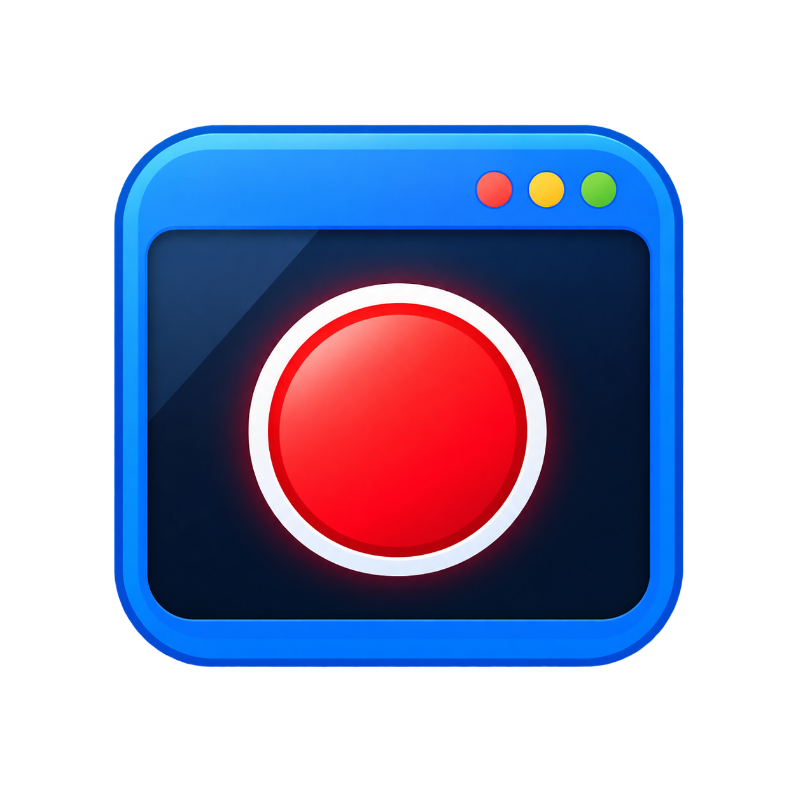
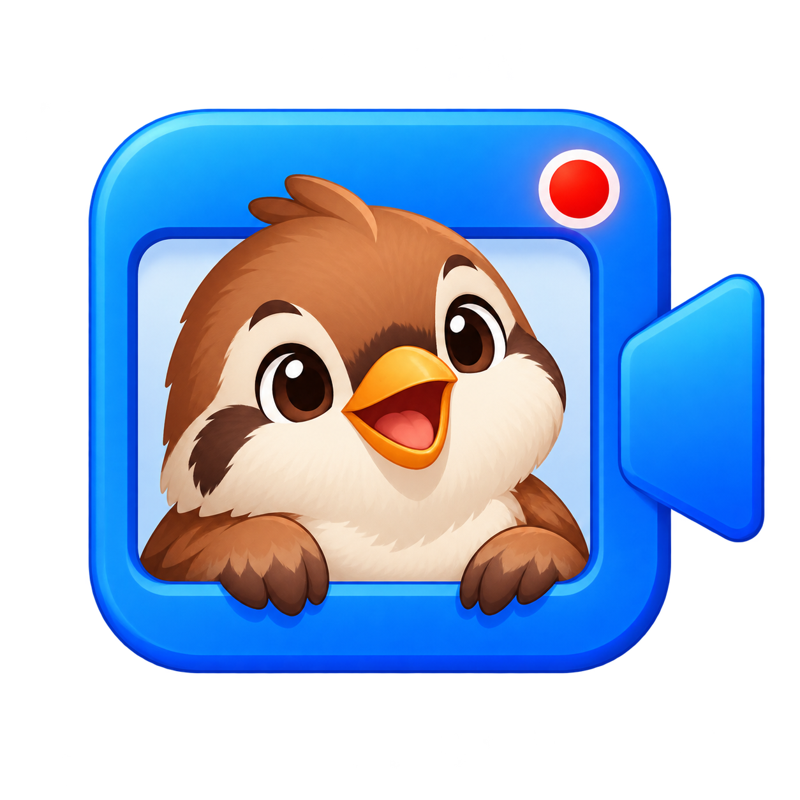
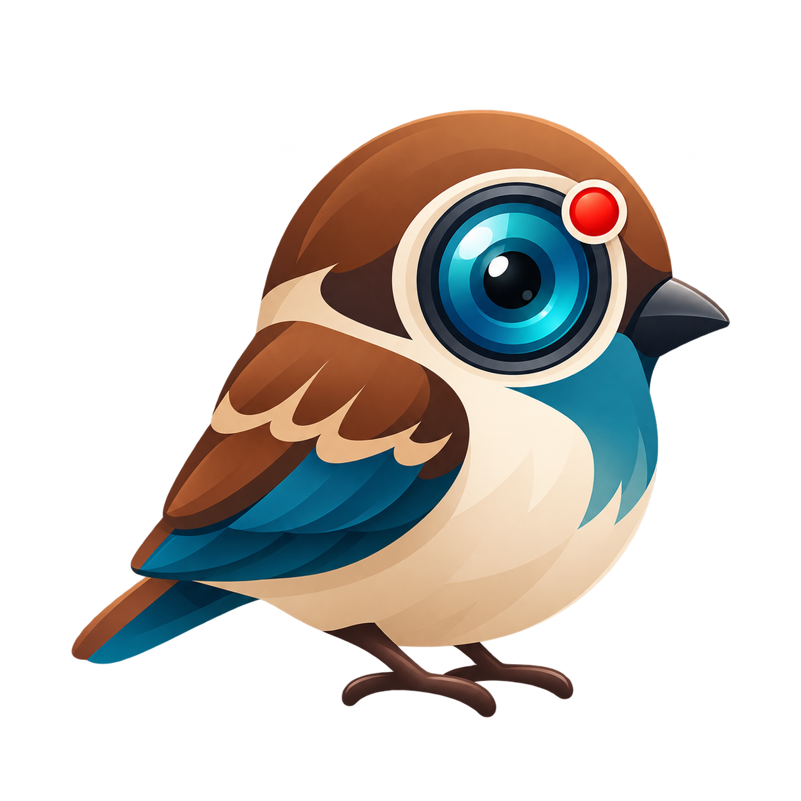
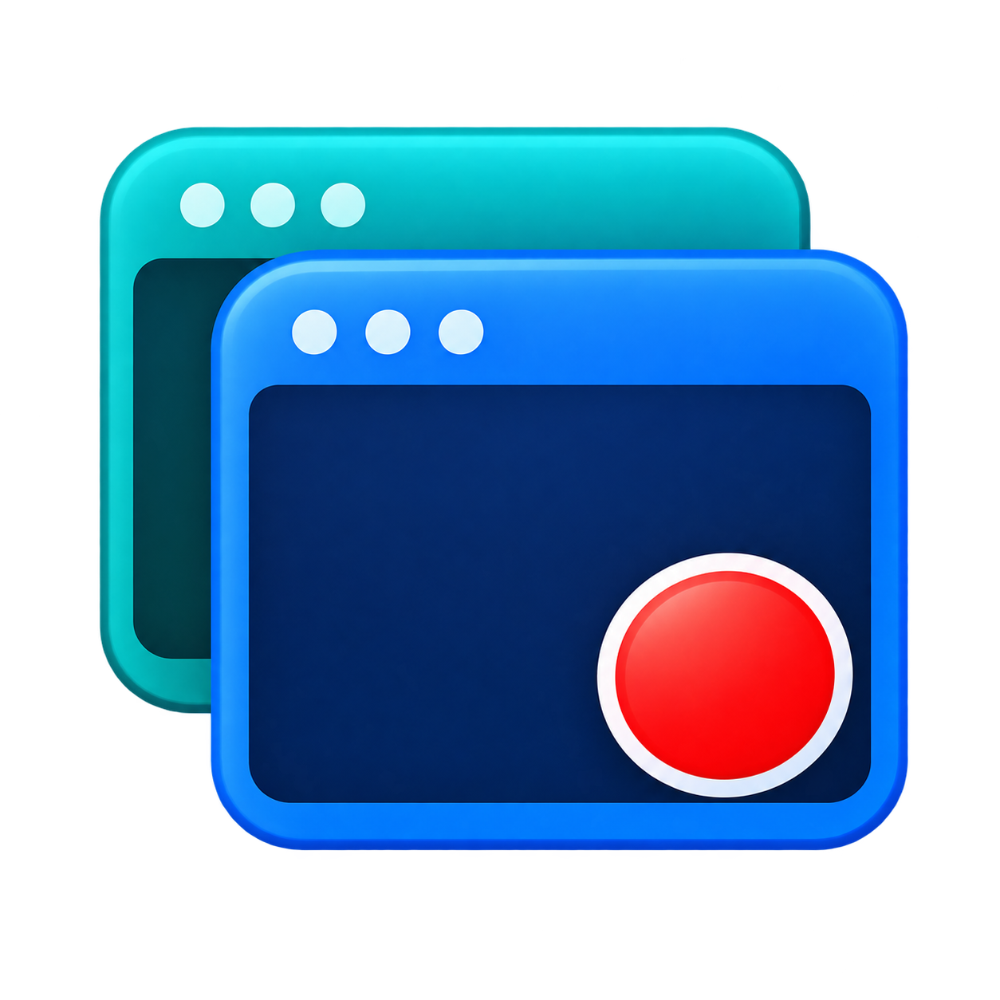
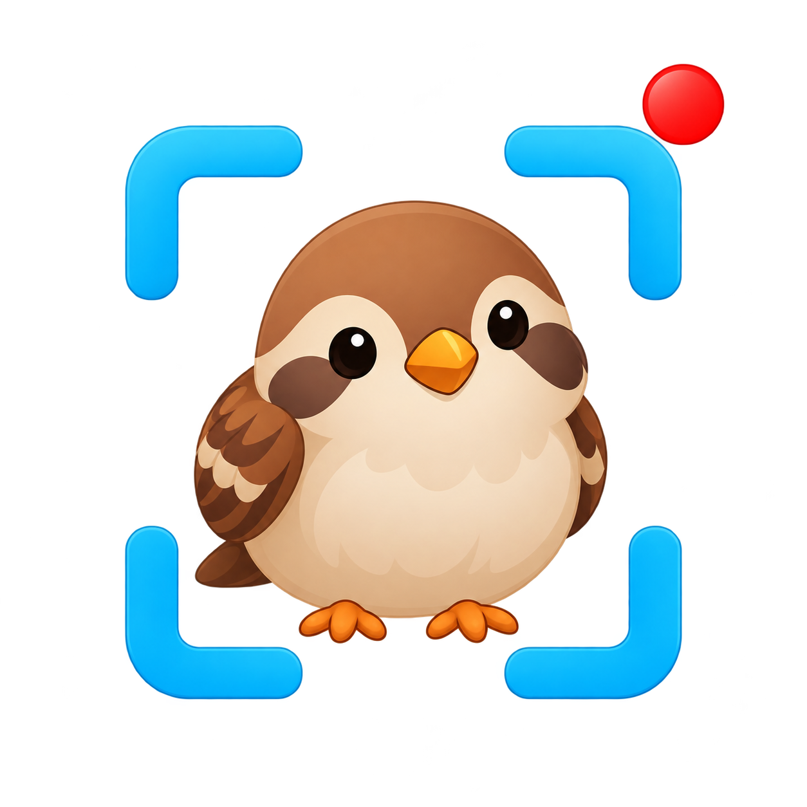
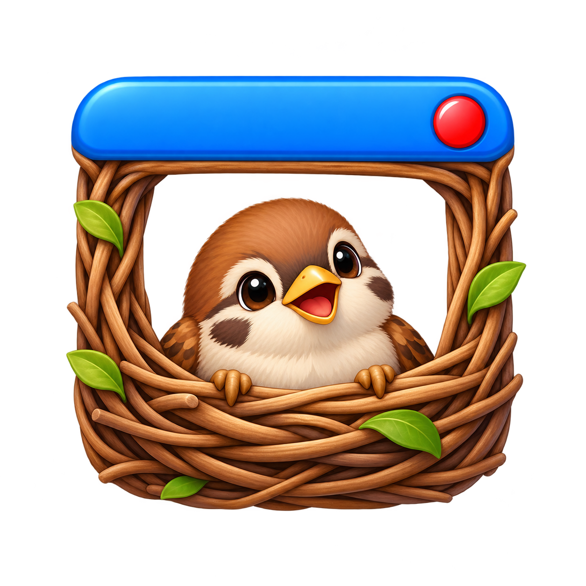

# CapchunWindow アイコン10案

採用前の画像案。元PNGは変更せず保存している。製品アイコンへの正式な反映は採用番号の指定後に行う。既存の共通アイコンを仮使用中。

[番号付きの比較画面](index.html)では明暗背景と16／32／48px表示を比較できる。

|番号|案|画像|
|---|---|---|
|01|青い窓と録画丸||
|02|窓から顔を出す小鳥||
|03|レンズの目を持つ小鳥||
|04|窓とビデオカメラ||
|05|重なる2枚の窓||
|06|再生マークと録画丸||
|07|キャプチャ枠と小鳥||
|08|配信するウィンドウ||
|09|CWモノグラム||
|10|窓の形の巣と小鳥||

生成は組み込みimage_genを使用。共通指定はWindowsアプリアイコン、単独の図案、透過背景、縮小時の判別性、余白、透かしやモックアップなし。01〜08と10は文字なし、09だけCWの文字を指定した。各案は前回提示した10のモチーフをそれぞれ個別の生成呼び出しで作成した。
